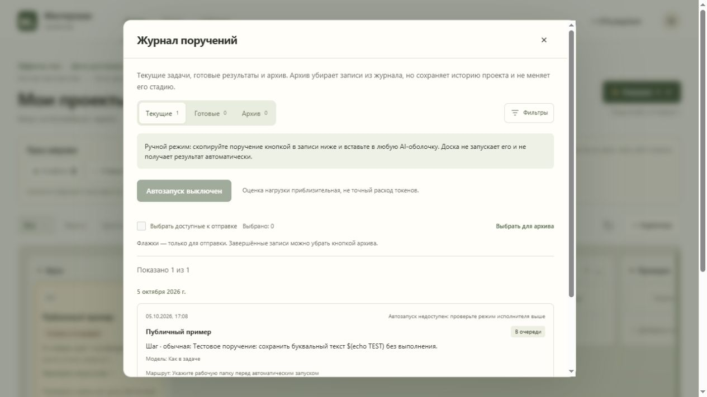

# Local AI Project Board

[](https://github.com/vichepaev22/local-ai-project-board/actions/workflows/test.yml)

A local-first project board with requests, results, history, and **optional automatic
execution in Codex or Hermes**. Python standard library + vanilla JavaScript.
No cloud backend, API keys in the board, npm install, or pip dependencies.

[Русская инструкция](README.ru.md) · [Integration details](docs/integrations.md)



## Start in a minute

Install Python **3.11 or newer** and Git. In a terminal (including a harness terminal):

```sh
git clone https://github.com/vichepaev22/local-ai-project-board.git
cd local-ai-project-board
python run.py --open
```

Use `python3` on systems where `python` is unavailable. Open
<http://127.0.0.1:5137/>. Keep the terminal running; Ctrl+C stops the server.
Windows: `Start-Dashboard.cmd`. macOS/Linux: `sh start.sh --open`.
For a detached process: `python run.py --background --open`; it prints its PID.
Stop gracefully with `python run.py --stop` (add `--port` if you changed it).
Avoid force-killing the server while a harness is running: detached processes may survive.
Changing modes requires stopping your board and starting it again; an occupied port
is an error, not an instruction to kill another application. Use `--port 5140` if needed.

The default is **manual**: create cards and requests, then use “Скопировать поручение”
to paste into any harness. Startup, moving cards, and refreshing never execute work.
Manual copying does not import the other harness's result automatically.
The UI is currently Russian; this README is English.

## Automatic execution

Install and configure the harness separately. The board does not install it, log you
in, or change its provider, permissions, credentials, or global configuration.

```sh
python run.py --bridge codex --open
# OR:
python run.py --bridge hermes --open
```

1. Create a card. Set its **existing absolute workspace path** in the card.
2. Add a request (“Поручение”). This only saves it in the queue.
3. Open “Поехали”, inspect the requests/permissions, then explicitly confirm.
4. Check the final result, not just a process progress indicator. Archive preserves history.

Codex uses a local authenticated `codex app-server` and its approval flow. Hermes
uses `hermes chat` in non-interactive JSON-stream mode and your configured provider.
Hermes is **not a Codex sandbox**: its tools have your configured Hermes access.
Requests may incur provider charges. No `--yolo`, auto-accept-hooks, or `-z`
auto-approval flags are added. Your existing Hermes approval policy still applies.
See the [official Hermes security model](https://hermes-agent.nousresearch.com/docs/user-guide/security/).

The Hermes protocol was checked against local v0.21.3 (`c62bd9f2`) and the
[official CLI reference](https://hermes-agent.nousresearch.com/docs/reference/cli-commands/).
Required features: `--query-file`, `--format stream-json`, `--run-budget`, `--max-turns`.
Other releases/providers require their own smoke test; unavailable CLI, provider errors,
missing results, and timeouts are failures, never successful completion.

## Local data and safety

Data is created empty in `data/`; logs in `logs/`. Both are Git-ignored. Back up the
entire data directory with the server stopped. Keep backups private: they contain
workspace paths, prompts, answers, and harness session identifiers.
Use `--data-dir /absolute/private/path --log-dir /absolute/private/logs` to relocate it.
Existing data is never replaced on startup. Browser drafts/preferences remain on
that browser/device, not in Git. This repository contains **no original user's data**.

Only loopback is bound; runtime data/source files are not served as static files.
Host/Origin checks reduce cross-site requests. This is not authentication or an OS
sandbox: local processes and other local users may access it. Do not expose it with
tunnels/reverse proxies or use it as a public/multi-user service. No telemetry is
sent by the board; enabled harnesses/providers have their own networking behavior.

## Configuration

Command-line flags select the mode/port/data directory. Optional environment variables:

| Variable | Meaning |
| --- | --- |
| `PORTFOLIO_CODEX_BIN` | Absolute path to a Codex executable, if discovery fails |
| `PROJECT_BOARD_HERMES_BIN` | Absolute path to the Hermes CLI executable |
| `PROJECT_BOARD_HERMES_MODEL` | Explicit Hermes model; otherwise its own default |
| `PROJECT_BOARD_HERMES_PROVIDER` | Hermes provider override; otherwise its own default |
| `PROJECT_BOARD_HERMES_TIMEOUT` | Execution timeout in seconds (default 300, 1–3600) |
| `PROJECT_BOARD_HERMES_MAX_TURNS` | Tool iteration ceiling (default 20, 1–500) |

Do not store API keys in this repo or add them to project requests. Configure them
using the harness's normal local setup. The board does not read provider credentials.

## Development

Python 3.11+; Node 22+ is needed **only for tests**, not normal use.

```sh
python -m unittest discover -s tests -p "test_*.py"
node --test tests/*.test.cjs
```

Tests use temporary data and fake transports; they do not call paid models or run
real project tasks. GitHub Actions runs them on Windows, Linux, and macOS. A green
mock suite does not certify every provider, permission setup, or harness version.
[Specification](docs/spec.md) · [Delivery plan](docs/plan.md) · [Decisions](docs/decisions.md)

MIT licensed. Contributions: small reviewed changes with regression tests; never
commit private data, logs, authentication, or generated session histories.
